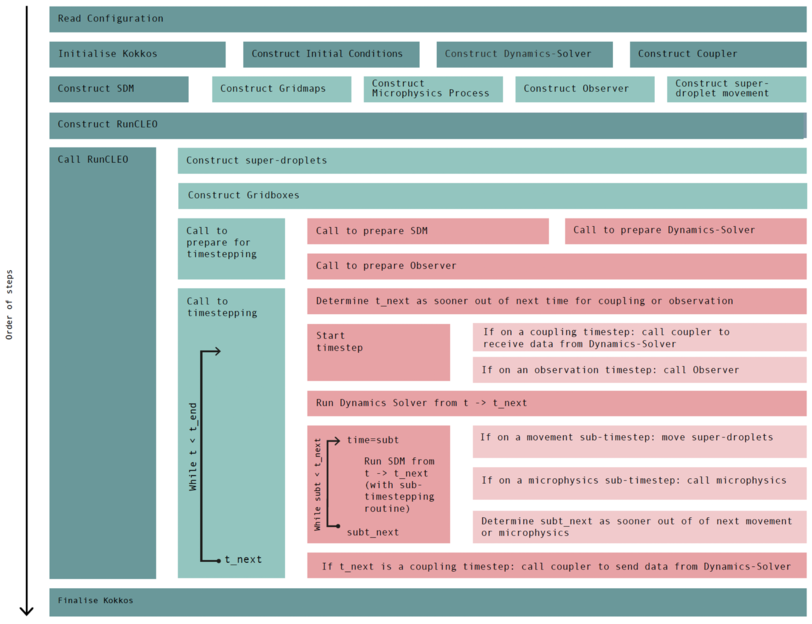

.. _main_cpp_page:

Understanding and Adapting ``main.cpp``
==========================================

Every Cleo executable is, in essence, one ``main.cpp`` file. Optionally this file is split into a
thin ``main.cpp`` plus a ``main_impl.hpp`` holding the "configuration" functions, as
``roughpaper/src/`` does.

This page walks through ``roughpaper/src/main.cpp`` and ``main_impl.hpp`` block by block to
show how each component of Cleo fits together and they *could* be configured. Treat
``roughpaper/src/`` as a template/scratchpad: it is supposed to be a source of inspiration or
experimentation, rather than "the" canonical example. You can build the ``roughpaper`` example with
the flag ``-DCLEO_NO_ROUGHPAPER=false`` (the default) but this ``roughpaper`` is really intended
just to illustrate the potential choices you *could* make when you create a Cleo simulation.
For examples where a particular model configuration is chosen, as you would do for your own setup,
look in ``CLEO/examples/`` (see :doc:`tutorial_new_example`).

The Overall Structure of a Cleo Executable
-------------------------------------------

At the top level, every Cleo executable follows the same 10 steps seen in its ``main(...)`` program:

1. Parse the ``YAML`` configuration file from the command line agruments to build a ``Config``.
2. Initialise a ``Communicator`` (for MPI and optionally YAC).
3. initialise ``Kokkos``.
4. Construct one ``SDMMethods`` object: everything needed for the SDM part of the model
   (an instantiated ``GridboxMaps``, ``MicrophysicalProcess``, ``MoveSupersInDomain``,
   and ``Observer``).
5. Construct the coupled dynamics (i.e. one object satisfying the ``CoupledDynamics`` concept).
6. Construct the coupler (i.e. one object satisfying the ``CouplingComms`` concept, or, more
   exactly, on object satisfying the ``CouplingComms<YourGridboxMaps, YourCoupledDynamics>``
   concept).
7. Construct the initial conditions (one object satisfying the ``InitialConditions`` concept).
8. Construct a ``RunCLEO`` object from the ``SDMMethods``, the ``CoupledDynamics``
   and ``CouplingComms`` objects
9. Call ``RunCLEO`` with the previously generated ``InitialConditions``;
   this runs the entire simulation.
10. Finalise Kokkos and exit.

The Structure in Code (the ``main`` function)
---------------------------------------------

The main function is the entry point of a Cleo executable. It is usually found in a ``main.cpp``
file and it implements the 10 steps listed above.

``main.cpp``
~~~~~~~~~~~~

In ``roughpaper/src/``, ``main.cpp`` itself is deliberately short, it contains only the ``main(...)``
function which does the 10 steps listed above. The details of how each of the 10 steps is implemented,
and the specific choices made for each step, are all kept separately in ``main_impl.hpp``.
Usually the contents of ``main_impl.hpp`` would instead be found at the top of ``main.cpp``,
as done in the ``CLEO/examples/``. For clarity however, in ``roughpaper/src/`` we seperate them.
Irrespective of where the specific implementaiton choices are written, the ``main(...)`` function
for Cleo should look as follows:

.. code-block:: cpp

    int main(int argc, char* argv[]) {
      if (argc < 2) {
        throw std::invalid_argument("configuration file(s) not specified");
      }

      Kokkos::Timer kokkostimer;

      /* STEP (1) Read input parameters from configuration file(s) */
      const std::filesystem::path config_filename(argv[1]);
      const Config config(config_filename);

      /* STEP (2) Initialize Communicator here */
      init_communicator init_comm(argc, argv, config);

      /* STEP (3) Initialise Kokkos parallel environment */
      Kokkos::initialize(config.get_kokkos_initialization_settings());
      {
        Kokkos::print_configuration(std::cout);

        const Timesteps tsteps(config.get_timesteps());

        auto store = FSStore(config.get_zarrbasedir());
        auto dataset = SimpleDataset(store);

        /* STEP (4) CLEO Super-Droplet Model (excluding coupled dynamics solver) */
        const SDMMethods sdm = create_sdm(config, tsteps, dataset, store);

        /* STEP (5) Solver of dynamics coupled to CLEO SDM */
        CoupledDynamics auto coupldyn =
            create_coupldyn(config, sdm.gbxmaps, tsteps.get_couplstep(), tsteps.get_t_end());

        /* STEP (6) Coupling between coupldyn and SDM */
        const CouplingComms<CartesianMaps, FromFileDynamics> auto comms = FromFileComms{};

        /* STEP (7) Initial conditions for CLEO run */
        const InitialConditions auto initconds = create_initconds(config, sdm.gbxmaps);

        /* STEP (8 and 9) Create and Run CLEO (SDM coupled to dynamics solver) */
        const RunCLEO runcleo(sdm, coupldyn, comms);
        runcleo(initconds, tsteps.get_t_end());
      }
      /* STEP (10) Finalize Kokkos and end program */
      Kokkos::finalize();

      const auto ttot = double{kokkostimer.seconds()};
      std::cout << "CLEO Total Program Duration: " << ttot << "s\n";
      return 0;
    }

In case you are wondering, the extra ``{ }`` block is because everything Kokkos-related must happen
*between* ``Kokkos::initialize`` and ``Kokkos::finalize`` — this is a Kokkos requirement, not a
Cleo-specific one.

Notice that every "ingredient" which is defined by a concept (``coupldyn``,
``comms``, ``initconds``) is declared using its concept name with ``auto``
(``CoupledDynamics auto coupldyn = ...``), never a concrete class name. This is what lets you swap
out template instantiations, e.g., ``FromFileDynamics`` for ``NullDynamics``, by editing only the
functions returns in ``main_impl.hpp``, and never having to touch ``main(...)`` itself. Similarly
the templated types that compose ``RunCLEO`` and ``SDMMethods`` are not explicitly written in
``main(...)`` and are thus also easily interchangeable.

``main_impl.hpp``
~~~~~~~~~~~~~~~~~~

``main_impl.hpp`` holds the ``create_*`` functions that ``main(...)`` calls. Reading it
top-to-bottom mirrors the order things are needed in ``main(...)``:

The first 3 steps are handled directly by various constructors and initializers, so the first
``create_*`` function is at step 4, ``create_sdm``. This function looks as follows:

.. code-block:: cpp

    template <typename Dataset, typename Store>
    inline auto create_sdm(const Config& config, const Timesteps& tsteps, Dataset& dataset, Store& store) {
      const auto couplstep = (unsigned int)tsteps.get_couplstep();
      const GridboxMaps auto gbxmaps = create_gbxmaps(config);
      const MicrophysicalProcess auto microphys = create_microphysics(config, tsteps);
      const MoveSupersInDomain movesupers = create_movement(config, tsteps, gbxmaps);
      const Observer auto obs = create_observer(config, tsteps, dataset, store);
      return SDMMethods(couplstep, gbxmaps, microphys, movesupers, obs);
    }

So, to create a SDMMethods struct, we need to four ingredients: a ``GridboxMaps``, a
``MicrophysicalProcess``, a ``MoveSupersInDomain`` struct, and an ``Observer``.
Starting with the ``GridboxMaps``, we call the ``create_gbxmaps`` function. This is the first
function found in ``main_impl.hpp`` and looks as follows:

.. code-block:: cpp

    inline GridboxMaps auto create_gbxmaps(const Config& config) {
      return create_cartesian_maps(config.get_ngbxs(), config.get_nspacedims(),
                                   config.get_grid_filename());
    }

Here we choose to create a cartesian domain geometry from the config's ``ngbxs``, number of
spatial dimensions, and the grid-boundaries binary file (see :doc:`tutorial_new_example`).

Next, we need to create the ``MicrophysicalProcess`` and so we call ``create_microphysics``, which,
in this example looks as follows:

.. code-block:: cpp

    inline MicrophysicalProcess auto create_microphysics(const Config& config, const Timesteps& tsteps) {
      const MicrophysicalProcess auto cond = config_condensation(config, tsteps);
      const MicrophysicalProcess auto colls = config_collisions(config, tsteps);
      return colls >> cond;
    }

where ``config_condensation`` and ``config_collisions`` are also defined in ``main_impl.hpp``:

.. code-block:: cpp

    inline MicrophysicalProcess auto config_condensation(const Config& config, const Timesteps& tsteps) {
      const auto c = config.get_condensation();
      return Condensation(tsteps.get_condstep(), &step2dimlesstime, c.do_alter_thermo, c.maxniters,
                          c.rtol, c.atol, c.MINSUBTSTEP, &realtime2dimless);
    }

    inline MicrophysicalProcess auto config_collisions(const Config& config, const Timesteps& tsteps) {
      const PairProbability auto collprob = LongHydroProb();
      const NFragments auto nfrags = ConstNFrags(config.get_breakup().constnfrags.nfrags);
      const CoalBuReFlag auto coalbure_flag = TSCoalBuReFlag(RogersGKTerminalVelocity{});
      return CoalBuRe(tsteps.get_collstep(), &step2realtime, collprob, nfrags, coalbure_flag);
    }

In ``create_microphysics`` we see the microphysics monoid combination from
:doc:`microphysics_and_observers` be used — here, condensation/evaporation is combined with
collisional coalescence/rebound/breakup (via ``CoalBuRe``, using a collision-outcome flag
``TSCoalBuReFlag`` and a number-of-fragments parameterisation ``ConstNFrags``).
Having a look inside ``main_impl.hpp`` and you will see as commented-out code several alternative
definitions of ``config_collisions`` and alternative configurations within each one — this
is meant as inspiration for you to choose how to setup your own example. For example you may instead
choose to only model collision-coalescence with one of the various definitions of the
collision-coalscence probabilitiy which Cleo has implemented, e.g. using:

.. code-block:: cpp

    inline MicrophysicalProcess auto config_collisions(const Config& config, const Timesteps& tsteps)
    {
      // const PairProbability auto coalprob = GolovinProb();
      // const PairProbability auto coalprob = LowListCoalProb(RogersGKTerminalVelocity{});
      // const PairProbability auto coalprob = LongHydroProb();  // assumes coaleff = 1.0
      const PairProbability auto coalprob =
          LongHydroProb(config.get_coalescence().constcoaleff.coaleff);

      const MicrophysicalProcess auto coal = CollCoal(tsteps.get_collstep(), &step2realtime,
          coalprob);

      return coal;
    }

with any one of the different definitions of ``coalprob`` compiled.

Next, we need to create a ``MoveSupersInDomain`` struct from the ``create_movement`` function,
e.g. as follows:

.. code-block:: cpp

    inline Motion<CartesianMaps> auto create_motion(const unsigned int motionstep) {
      const auto terminalv = RogersGKTerminalVelocity{};
      return CartesianMotion(motionstep, &step2dimlesstime, terminalv);
    }

    inline BoundaryConditions<CartesianMaps> auto create_boundary_conditions(const Config& config) {
      return NullBoundaryConditions{};
    }

    template <GridboxMaps GbxMaps>
    inline auto create_movement(const Config& config, const Timesteps& tsteps, const GbxMaps& gbxmaps) {
      const Motion<CartesianMaps> auto motion = create_motion(tsteps.get_motionstep());
      const BoundaryConditions<CartesianMaps> auto boundary_conditions =
          create_boundary_conditions(config);
      return cartesian_movement(gbxmaps, motion, boundary_conditions);
    }

Here we use the ``cartesian_movement`` to create the ``MoveSupersInDomain`` struct we need for
motion of super-droplets in a cartesian domain. For ``cartesian_movement`` we require some kind of
superdroplet motion and some boundary conditions (see :ref:`why_code_structure`). For the
superdroplet motion we call ``create_motion`` which creates ``CartesianMotion`` using a
terminal-velocity formula (here, ``RogersGK`` but ``main_impl.hpp`` shows several alternatives
such as ``NullTerminalVelocity`` or ``SimmelTerminalVelocity``). For the boundary conditions
we call our ``create_boundary_conditions`` function which creates ``NullBoundaryConditions`` in this
example. We could equally well however, have chosen different boundary conditions, e.g.
``AddSupersToDomain`` (again, as shown in ``main_impl.hpp``) to remove spare super-droplets and
create new ones at the top/bottom of the domain.

Finally, we need to creaet the ``Observer`` and for this we call ``create_observer``. Depening on
the desired output of a simulation, there are a great many ways to design this function, see
:doc:`microphysics_and_observers` and ``main_impl.hpp`` for more details. Then as last we are
able to understand the ``create_sdm`` function shown at the start:

.. code-block:: cpp

    template <typename Dataset, typename Store>
    inline Observer auto create_observer(const Config& config, const Timesteps& tsteps,
                                         Dataset& dataset, Store& store) {
      // ... builds and combines ~9 observers, see
    }

    template <typename Dataset, typename Store>
    inline auto create_sdm(const Config& config, const Timesteps& tsteps, Dataset& dataset, Store& store) {
      const auto couplstep = (unsigned int)tsteps.get_couplstep();
      const GridboxMaps auto gbxmaps = create_gbxmaps(config);
      const MicrophysicalProcess auto microphys = create_microphysics(config, tsteps);
      const MoveSupersInDomain movesupers = create_movement(config, tsteps, gbxmaps);
      const Observer auto obs = create_observer(config, tsteps, dataset, store);
      return SDMMethods(couplstep, gbxmaps, microphys, movesupers, obs);
    }

In step 5 of main(...), we create the coupled dynamics through ``create_coupldyn``,
for example, for reading data from a file, the function is as follows:

.. code-block:: cpp

    inline CoupledDynamics auto create_coupldyn(const Config& config, const CartesianMaps& gbxmaps,
                                                const unsigned int couplstep, const unsigned int t_end) {
      const auto h_ndims = gbxmaps.get_global_ndims_hostcopy();
      const std::array<size_t, 3> ndims({h_ndims(0), h_ndims(1), h_ndims(2)});
      const auto nsteps = (unsigned int)(std::ceil(t_end / couplstep) + 1);
      return FromFileDynamics(config.get_fromfiledynamics(), couplstep, ndims, nsteps);
    }

and is associated in step 6 of ``main(...)`` with ``comms = FromFileComms{}``. See
:doc:`coupled_dynamics` and the Cleo examples for alternative coupled dynamics and couplers. As
a concrete example (condensed from :doc:`coupled_dynamics`'s worked example): switching
an example from reading dynamics from file to having no dynamics at all only requires changing
two things in ``main_impl.hpp``/``main.cpp``, everything else is untouched:

.. code-block:: cpp

    // before: one-way coupled to binary files
    inline CoupledDynamics auto create_coupldyn(const Config& config, const CartesianMaps& gbxmaps,
                                                const unsigned int couplstep, const unsigned int t_end) {
      const auto h_ndims = gbxmaps.get_global_ndims_hostcopy();
      const std::array<size_t, 3> ndims({h_ndims(0), h_ndims(1), h_ndims(2)});
      const auto nsteps = (unsigned int)(std::ceil(t_end / couplstep) + 1);
      return FromFileDynamics(config.get_fromfiledynamics(), couplstep, ndims, nsteps);
    }
    // in main(...):
    const CouplingComms<CartesianMaps, FromFileDynamics> auto comms = FromFileComms{};

.. code-block:: cpp

    // after: no coupled dynamics at all
    inline CoupledDynamics auto create_coupldyn(const Config& config, const CartesianMaps& gbxmaps,
                                                const unsigned int couplstep, const unsigned int t_end) {
      return NullDynamics(couplstep);
    }
    // in main(...):
    const CouplingComms<CartesianMaps, NullDynamics> auto comms = NullDynComms{};

You would also need to update your executable's ``CMakeLists.txt`` to link ``coupldyn_null`` instead of
``coupldyn_fromfile``, and (if you no longer need it) remove the ``fromfiledynamics`` block from
your YAML configuration file (see :doc:`tutorial_new_example`).

.. admonition:: Common pitfall

   Forgetting to update the ``CMakeLists.txt`` link line after changing which ``coupldyn_*``
   header you ``#include`` produces a *linker* error (undefined reference), not a compiler error —
   if you see undefined references to symbols that plainly exist in a header you're including,
   check which libraries your executable's ``target_link_libraries`` lists. This also applies
   when you change other model components not just ``coupldyn_*``, e.g. if you change/add
   observers to construct the combined ``Observer`` you want to use!

In step 7 of ``main(...)``, we construct the initial conditions through the ``create_initconds``
function. For example, we can use the following function:

.. code-block:: cpp

    template <GridboxMaps GbxMaps>
    inline InitialConditions auto create_initconds(const Config& config, const GbxMaps& gbxmaps) {
      const auto initsupers = InitSupersFromBinary(config.get_initsupersfrombinary(), gbxmaps);
      const auto initgbxs = InitGbxsNull(gbxmaps.get_local_ngridboxes_hostcopy());
      return InitConds(initsupers, initgbxs);
    }

which constructs the initial conditions for superdroplets by reading a binary file
(``InitSupersFromBinary``), and constructs "Null" initial conditions for the gridboxes'
thermodynamic state (``InitGbxsNull``). Here, "Null" means: don't set initial conditions for
gridboxes (its either not necessary for the simulation or will come from the coupled dynamics
at the start of the very first time step). Alternative initial conditions are
``InitAllSupersFromBinary`` and ``InitGbxsCvode``, which are demonstated in Cleo's examples.

... And that's it! We've now gone through the entire overall structure of a cleo executable as
set-up in a ``main.cpp`` (and ``main_impl.hpp``) - congratulations!!

.. _main_cpp_summary:

How Things Fit Together — Summary
-----------------------------------

What Can Change
~~~~~~~~~~~~~~~~

.. list-table::
   :header-rows: 1
   :widths: 30 70

   * - To change...
     - ...edit this factory function in ``main_impl.hpp``
   * - Domain geometry / resolution
     - ``create_gbxmaps`` (→ and the grid-boundaries input file, see :doc:`tutorial_new_example`)
   * - Movement (superdoplet motion / terminal velocity / boundary conditions)
     - ``create_movement`` (→ ``create_motion``, ``create_boundary_conditions``)
   * - Microphysics (condensation/evaporation, collision-coalescence +- breakup +- rebound)
     - ``create_microphysics`` (→ ``config_condensation``, ``config_collisions``) — see
       :doc:`microphysics_and_observers`
   * - Observer (what gets output)
     - ``create_observer`` (→ ``create_superdrops_observer``,
       ``create_gridboxes_observer``, ...) — see :doc:`microphysics_and_observers`
   * - Coupled dynamics (null / from-file / CVODE / YAC)
     - ``create_coupldyn``, and ``CouplingComms<...>`` — see
       :doc:`coupled_dynamics`
   * - Initial conditions
     - ``create_initconds`` (→ ``initsupers = ...``, ``initgbxs = ...``)

What Typically Should *Not* Change
~~~~~~~~~~~~~~~~~~~~~~~~~~~~~~~~~~~~~

* The overall structure of ``main(...)`` (the 10 steps listed at the top of this page) — Cleo's
  timestepping and coupling logic lives in ``RunCLEO``/``SDMMethods``, not in ``main(...)``, and
  should not be reimplemented per-example.
* The ``Kokkos::initialize``/``{ ... }``/``Kokkos::finalize`` structure and its ordering relative
  to everything else.
* Signatures of the ``create_*`` functions, unless you are also changing what calls them — many
  of them are templated on ``Dataset``/``Store``/``GbxMaps`` specifically so they can be reused
  unchanged across examples with different concrete types.

.. _main_cpp_timestepping_runcleo:

The Call to ``RunCleo``: Time-stepping Cleo
--------------------------------------------

Perhaps now you want to know a bit more about how the call to ``RunCleo`` actually runs the
simulation...

Recall that ``main(...)`` hands ``sdm``, ``coupldyn`` and ``comms`` to a ``RunCLEO`` structure and
calls it (i.e. calls its operator). Inside ``libs/runcleo/runcleo.hpp``, the ``RunCLEO::operator()``
creates the initial gridboxes/super-droplet arrays from the initial conditions and then
runs ``timestep_cleo``:

.. code-block:: cpp

    int timestep_cleo(const unsigned int t_end, const dualview_gbx gbxs,
                      SupersInDomain& allsupers) const {
      unsigned int t_mdl(0);
      while (t_mdl <= t_end) {
        const auto t_next = start_step(t_mdl, gbxs, allsupers);   // 1. receive dynamics, observe
        coupldyn_step(t_mdl, t_next);                              // 2. advance coupled dynamics
        sdm_step(t_mdl, t_next, gbxs, allsupers);                  // 3. advance SDM (motion+microphysics)
        t_mdl = proceed_to_next_step(t_next, gbxs);                // 4. send dynamics back out
      }
    }

with ``t_next`` chosen adaptively each iteration as the sooner of the next coupling time and the
next observation time (``get_next_step``, mirroring the general pattern in
:doc:`../intro/timestepping`), and with ``sdm_step`` internally running its own nested
sub-timestepping loop (in ``SDMMethods::run_step``, ``libs/runcleo/sdmmethods.hpp``) so that
super-droplet motion and each microphysical process can each use their own, independently
adaptive sub-timestep, down to the granularity of ``t_next - t_mdl``.

Recall this diagram?

   This is the same routine-calling diagram from :doc:`../intro/timestepping`, but now perhaps you
   can recognice some of the steps in the functions above, e.g. "construct SDM" → ``create_sdm``,
   "Construct Dynamics Solver" → ``create_coupldyn``, and in ``RunCleo``: "start step" → ``start_step``,
   "run coupled dynamics" → ``coupldyn_step``, "run SDM" → ``sdm_step``
   (itself nesting motion and microphysics sub-steps), "proceed" → ``proceed_to_next_step``.

----

.. note::
   This page was generated by Claude (Anthropic), at the request of Clara Bayley, based on
   Cleo's design and numerics papers (Bayley et al. 2026, GMD 19, 6099-6120 and 6121-6142) and
   the Cleo source code. Please check it for accuracy and open an issue or get in touch if you
   spot anything wrong or out of date.
